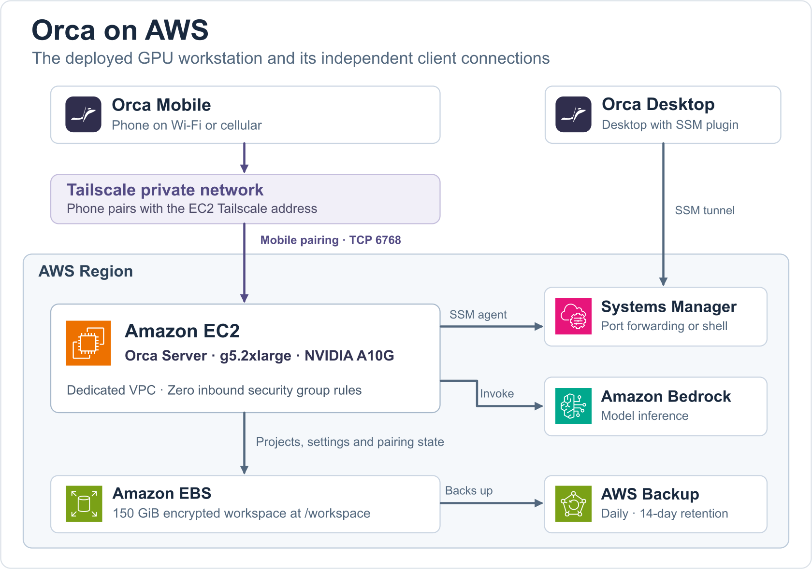

# AWS Orca

Deploy a persistent Linux workstation on Amazon EC2 for Orca Desktop and Android. Codex and OpenCode can share one workstation and use Amazon Bedrock inference. Projects, agent configuration, and Orca pairing state live on a separate encrypted disk. A paired phone connects directly to EC2 through Tailscale, including when the laptop is asleep.

We wanted a cloud version of a development laptop. An early CPU workstation ran agents against Bedrock. A project SDK then needed CUDA on the machine doing the development. We moved to a `g5.2xlarge` with 8 vCPUs, 32 GiB RAM and one NVIDIA A10G. Codex and OpenCode continued calling Bedrock. On 20 November 2026 the workstation was running in `us-east-1` with an encrypted 30 GiB root disk and a separate encrypted 150 GiB workspace, both gp3. A desktop tunnel and an independent mobile route let each client reconnect to the work.



[Scalable diagram](docs/images/orca-on-aws-architecture.svg) · [Seven days of deployment decisions and checks](docs/deployment-experience.md) · [AWS architecture icons](https://aws.amazon.com/architecture/icons/) · [Orca logo](https://github.com/stablyai/orca/blob/v1.4.265/resources/logo.svg)

AWS permissions follow the workload. The instance profile supplies temporary Bedrock credentials to Codex and OpenCode, and a separate service role backs up the workspace. Inside EC2, Orca runs as an unprivileged Linux user. Project SDKs need writable environments and, for CUDA, access to the GPU devices. Each agent's tool approval setting governs when it asks before using those permissions. [Choosing the right permission](docs/security.md#which-permission-to-change)

| Agent | Status | Inference |
| --- | --- | --- |
| [Codex](agents/codex-bedrock/README.md) | Deployable | Amazon Bedrock, GPT-6.2 Sol by default |
| [OpenCode](agents/opencode-bedrock/README.md) | Fresh host or add to existing Orca | Bedrock only, full upstream Bedrock picker |
| [Kiro CLI](agents/kiro-cli/README.md) | Orca terminal agent, Kiro sign-in required | Bedrock through the Kiro service |
| [Claude Code](agents/claude-code-bedrock/README.md) | Planned | Amazon Bedrock |

## Deploy

Use Python 3.9+, AWS CLI v2, an AWS CLI profile with deployment permissions, and a region with the chosen instance type. Install the AWS Session Manager plugin on your computer for the first connection. Install Orca Desktop or Orca Mobile on the clients you want to pair. Mobile also needs a Tailscale account and the Tailscale app. [AWS CLI installation](https://docs.aws.amazon.com/cli/latest/userguide/getting-started-install.html) · [Session Manager plugin](https://docs.aws.amazon.com/systems-manager/latest/userguide/session-manager-working-with-install-plugin.html) · [Orca releases](https://github.com/stablyai/orca/releases) · [Tailscale clients](https://tailscale.com/download)

1. Clone the tagged reference and preview the deployment. Version 0.2.0 defaults to the deployed G5 and disk sizes for a new stack. G5 costs more to run than T3. If your builds and SDKs only need CPU, set `ORCA_INSTANCE_TYPE=t3.large` in the example. The preview resolves an AMI and an offered Availability Zone, then validates the template with CloudFormation.

   ```sh
   git clone --branch v0.2.0 https://github.com/windson/orca-on-aws.git
   cd orca-on-aws
   aws sts get-caller-identity --profile default
   ORCA_INSTANCE_TYPE=g5.2xlarge
   python3 tools/deploy.py --stack aws-orca --region us-east-1 \
     --instance-type "$ORCA_INSTANCE_TYPE" --root-gib 30 --workspace-gib 150 --plan
   ```

2. Create the workstation with a new stack name. Creation waits for the disk mount, Orca listener, owner CLI, and agent setup. The command prints the instance ID, backup vault, and workspace volume ID. Reusing an existing stack name returns an error.

   ```sh
   python3 tools/deploy.py --stack aws-orca --region us-east-1 \
     --instance-type "$ORCA_INSTANCE_TYPE" --root-gib 30 --workspace-gib 150
   ```

3. Open an administrative session from the same computer. The following commands are for a POSIX shell. On Windows, use WSL or pass the instance ID from the stack outputs to the AWS CLI in PowerShell.

   ```sh
   HOST_ID=$(aws cloudformation describe-stacks --stack-name aws-orca --region us-east-1 --profile default \
     --query "Stacks[0].Outputs[?OutputKey=='InstanceId'].OutputValue | [0]" --output text)
   aws ssm start-session --target "$HOST_ID" --region us-east-1 --profile default
   ```

4. For the default Codex deployment, run one small inference request inside that session. A successful check ends with exit code zero after Codex returns `ORCA_READY`. This request incurs Bedrock usage. For Kiro, pair the client and complete the remote sign-in in its agent guide. [Desktop and Android pairing](docs/access.md) · [Codex setup and first chat](agents/codex-bedrock/README.md) · [Kiro sign-in and first chat](agents/kiro-cli/README.md)

   ```sh
   sudo /opt/orca-workstation/agent/verify.sh --inference
   ```

The GPU example incurs G5 compute charges while running. The stock AMI needs an NVIDIA driver for CUDA workloads. Use a compatible GPU-ready AMI with `--ami-id` on both commands, or install the driver after boot. Check G-instance quotas, regional availability and Bedrock access first. EC2, EBS, snapshots, public IPv4, detailed monitoring and inference have separate charges. The reference schedules daily workspace backups with 14-day retention. [GPU setup, costs, backup and teardown](docs/operations.md) · [AWS Pricing Calculator](https://calculator.aws/)

## Layout

| Directory | Responsibility |
| --- | --- |
| `infra/aws/` | VPC, EC2, storage, backup and shared IAM |
| `platform/host/` | First boot, workspace mount and health checks |
| `platform/orca/` | Pinned Orca server, systemd service and optional worktree dependency setup |
| `platform/access/` | Tailscale enrollment support and host firewall |
| `platform/integrations/` | Optional tools shared by agents, currently GitHub CLI |
| `agents/<name>/` | One coding agent's packages, inference permissions, configuration and checks |
| `tools/` | Compose the template and deploy to a fresh stack |
| `tests/` | Offline regression checks |

Run `python3 -m unittest discover -s tests` to test a checkout. Use `python3 tools/render.py > template.json` to inspect the standalone template. All host setup files are embedded in the rendered output. The instance downloads published packages during boot and needs no access to a fork of this repository. [Workspace setup and GitHub](docs/workspaces.md) · [Agent module contract](agents/README.md) · [Access and IAM design](docs/security.md)

The MIT license covers the reference code. Orca, Codex, Tailscale and other distributed software retain their respective licenses. This is an independent deployment reference.
